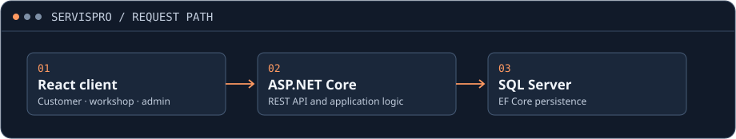

# ServisPro

**Full-stack engineering documentation · Independent university project**

ServisPro is an auto-service booking and management application. Customers manage vehicles and book appointments. Workshops manage calendars and service work. Administrators review service providers and maintain the catalog.

<picture>
  <source media="(max-width: 560px)" srcset="assets/architecture-mobile.svg">
  
</picture>

**React · ASP.NET Core · Entity Framework Core · SQL Server**

[Engineering overview](docs/engineering-overview.md) · [Requirements](PSD_AV04_Specifikacija_zahteva.doc) · [Architecture specification](PSD_AV05_Detaljni_arhitekturni_projekat_v1.0.doc)

## Three workflows

| Role | Example workflow |
| --- | --- |
| Customer | Browse workshops, register a vehicle, request an appointment, and review its status. |
| Workshop | Manage calendar availability, review bookings, and record vehicle service history. |
| Administrator | Review pending workshops and maintain users, service types, and vehicle reference data. |

## Documentation index

| Start here for | Material |
| --- | --- |
| Scope and project planning | [Project definition](Definicija%20projekta.docx) · [Delivery plan](PSD_AV02_Plan_realizacije_projekta.doc) · [Schedule](PSD_AV02_Raspored_aktivnosti.mpp) |
| Product and requirements | [System vision](PSD_AV03_Vizija_sistema.doc) · [Requirements specification](PSD_AV04_Specifikacija_zahteva.doc) · [Requirements model](Specifikacija_zahteva_ServisPro.mdj) |
| Design and implementation context | [Engineering overview](docs/engineering-overview.md) · [Detailed architecture](PSD_AV05_Detaljni_arhitekturni_projekat_v1.0.doc) · [Architecture model](DetaljniArhitekturniProjekat.mdj) |
| Verification and user guidance | [Test plan](PSD_AV06_Plan_testiranja.doc) · [Test specification](PSD_AV07_Test_specifikacija.docx) · [User guide](PSD_AV08_Korisnicko_Uputstvo_Web.doc) |

The original course documents are in Serbian. Office, Project, and model files may need a compatible desktop viewer. This repository contains the engineering documentation. A public running demo and application source release are not available here.

**Role:** I developed the React frontend and ASP.NET Core backend independently as a university project.
